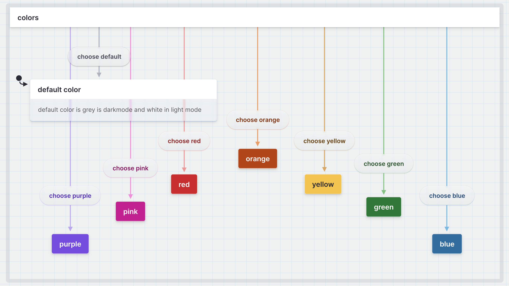
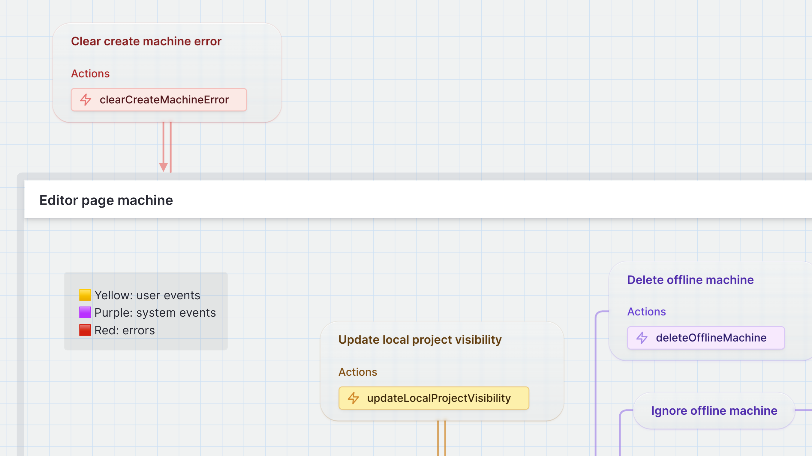

import machine_8b2c257c from '@/public/viz-snapshots/8b2c257c-2060-45a5-bdb1-e91b7f5c9318.json';
import machine_35d9c021 from '@/public/viz-snapshots/35d9c021-9b00-4c6f-85c9-1f2fece5d0c5.json';
import machine_e35f9079 from '@/public/viz-snapshots/e35f9079-722e-4812-8103-e63ada46456f.json';
import machine_9a62b8b1 from '@/public/viz-snapshots/9a62b8b1-b5a3-4b15-a5ed-acfe5f65da80.json';

As part of our recent colossal release, we’ve launched a new feature for pro users - [colors](/docs/colors). With this feature, you can add a layer of visual distinction to your statecharts, making them more organized, informative, and accessible for your team to understand.

{/* truncate */}

## How can I use colors in Stately?

You can assign colors from the palette menu to different states and transitions in your flows. You can choose from various color options, including pink, purple, red, orange, yellow, green, and blue. You can also reset a state or transition back to the default color; gray in dark mode and white in light mode.

## Why use colors?

Many folks requested colors for their state machines, not just because colors make everything prettier! The bigger a machine gets, the more you want to distinguish or draw attention to particular states or transitions.

### Color coding groups or types of states or events

One common use is to connect color to a meaning, such as making error states red and success states green. You could set transition colors to identify a common target, shared source, or group states and transitions meaningfully for your team.

<Embed machine={machine_8b2c257c} name="Editor page machine" />

The machine above uses yellow for user events, purple for system events, and red for errors.

### Organize flows into regions with distinct colors

Some other ways to use color are to use different colors to highlight different user personas or stories or mark popular paths through your app based on usage data.

<Embed machine={machine_35d9c021} title="Flow organized into colored regions" />

### Use color for fun!

Or maybe you want to use color for fun. You can use color to decorate your flows to fit your brand or decorate your states and transitions.

<Embed machine={machine_e35f9079} name="Traffic light machine" />

## How to use colors in your flows

Read more about [adding colors](/docs/colors) and [upgrading to a Pro account](/docs/upgrade) in our docs.

If you want to explain your color coding, we’ve had success using an annotation box as a key to help others understand the meaning behind each color.

When using colors to convey information, it is essential to keep accessibility in mind. Not everyone perceives color the same way, and as many as 8% of men and 0.5% of women are color blind. Ensure your statecharts are inclusive by using color to emphasize or decorate your machines, and [do not use color as the only way to convey information](https://www.w3.org/WAI/WCAG21/Understanding/use-of-color.html).

To make your colored machines more accessible, add the color or symbolic name as a tag on your states and transitions, or include them in their descriptions.

<Embed machine={machine_9a62b8b1} name="Expense machine" />

Colors are a powerful feature that helps you improve your statecharts' organization, clarity, and user-friendliness. To learn more about using Colors, check out our [documentation](/docs/colors).

## More Pro features

Colors is one of many Pro features we've recently added to Stately. Our current Pro features include:

- [Teams and shared projects](/docs/teams)
- [Private and unlisted projects](/docs/projects#change-a-projects-visibility)
- [Version history](/docs/versions)
- [Import from GitHub](/docs/import-from-github)
- [Live simulation mode](/docs/live-simulation)
- [Color states and transitions](/docs/colors)
- [Priority support](/docs/studio-pro-plan#priority-support)
- GitHub Sync (coming soon!)
- Workflows (coming soon!)
- Live collaboration (coming soon!)

And we've got many more coming soon! Want to suggest a feature? Leave a feature request on our feedback board or upvote other features we should prioritize.

Want to try the Pro plan? You can get a free trial when you [join from our website](/pricing) or [upgrade](/docs/upgrade) from [the editor](https://state.new).
